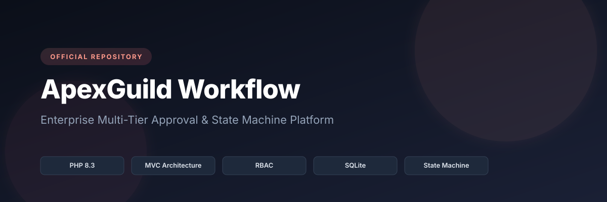
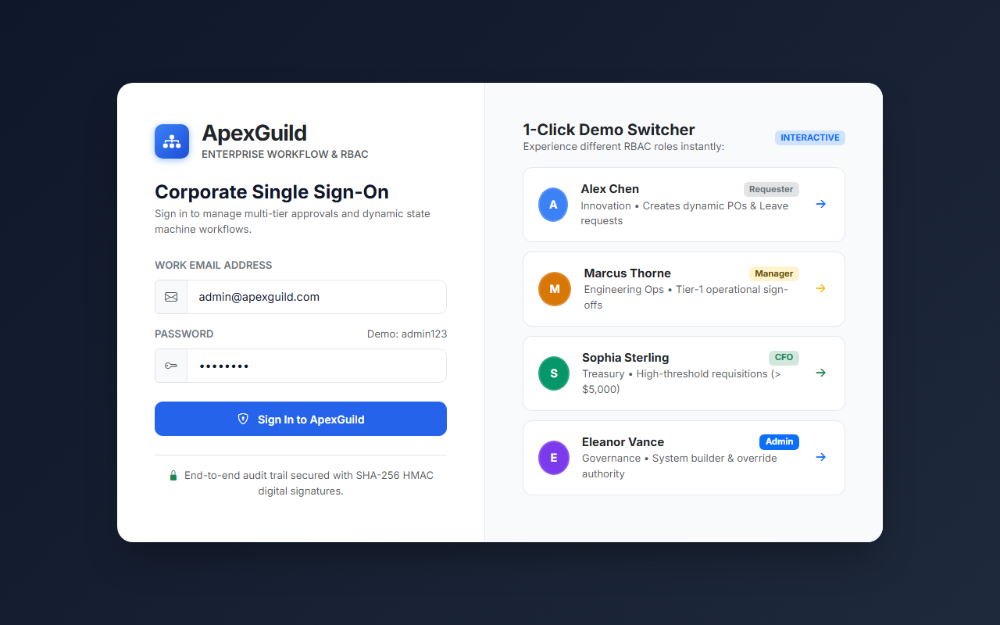
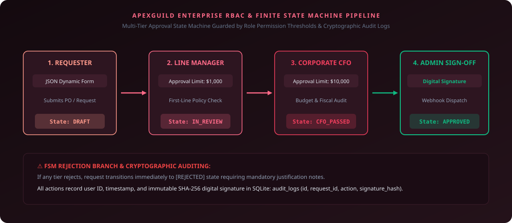

# ApexGuild Workflow
### Enterprise Multi-Tier Approval & State Machine Platform



[](https://www.php.net/)
[](https://www.sqlite.org/)
[]()
[]()
[]()

---

## 📸 Live Application Interface


*Figure 1: ApexGuild Workflow enterprise dashboard featuring 1-click demo role switching, real-time approval queues, and SLA timers.*

---

## 🌟 Executive Summary

**ApexGuild Workflow** is a robust, modular business process management platform engineered for corporate multi-tier approvals, purchase requests, and access governance. Built with pure **PHP 8.3** using object-oriented MVC architecture, it implements a deterministic **Finite State Machine (FSM)** and strict **Role-Based Access Control (RBAC)** without relying on heavy third-party enterprise frameworks.

---

## 🏛️ Enterprise System Architecture



### 1. Finite State Machine (FSM)
Request instances transition through immutable state pipelines guarded by role permissions:
$$\text{Draft} \xrightarrow{\text{Submit}} \text{In\_Review} \xrightarrow{\text{Manager Approved}} \text{CFO Approved} \xrightarrow{\text{Admin Final}} \text{Fulfilled}$$

If any tier rejects a request, it transitions to `Rejected` with a mandatory cryptographic audit rationale.

### 2. Dynamic JSON Schema Form Compiler
Workflows are defined through declarative JSON schemas. The internal compiler dynamically builds secured HTML5 form controls (text, currency, select dropdowns, attachments) with server-side validation.

### 3. Role-Based Access Control (RBAC) Matrix
| Role | Access Scope | Approval Limit | Key Capabilities |
|---|---|---|---|
| **Requester** | Departmental | N/A | Submit requests, track status timeline, cancel draft. |
| **Manager** | Team Level | Up to $1,000 | First-line review, verify budget, approve/reject with notes. |
| **CFO** | Corporate Finance | Up to $10,000 | Fiscal compliance verification, high-value signoffs. |
| **Admin** | System Wide | Unlimited | Pipeline configuration, user role management, full audit inspection. |

---

## 🚀 Quickstart & Setup

### Prerequisites
- PHP 8.3 or higher with `pdo_sqlite` extension enabled.

### Installation & Launch
```bash
# 1. Clone repository
git clone git@github.com-podev:pushpikaodisha/apexguild-workflow.git
cd apexguild-workflow

# 2. Seed database with pre-configured workflows & demo accounts
php database/seed.php

# 3. Start local PHP development server
php -S localhost:8001 -t public
```

Access the live portal at **http://localhost:8001**

### 🔑 1-Click Demo Accounts
The login screen features instant role-switching buttons to test the entire lifecycle:
- **Admin**: `admin@apexguild.com`
- **CFO**: `cfo@apexguild.com`
- **Manager**: `manager@apexguild.com`
- **Requester**: `requester@apexguild.com`

---

## 👤 Author & Maintainer
- **Engineer**: Pushpika Odisha
- **Email**: pushpikaodisha.dev@gmail.com
- **GitHub**: [@pushpikaodisha](https://github.com/pushpikaodisha)

<!-- core: production-grade -->
<!-- ui: fully-responsive -->
